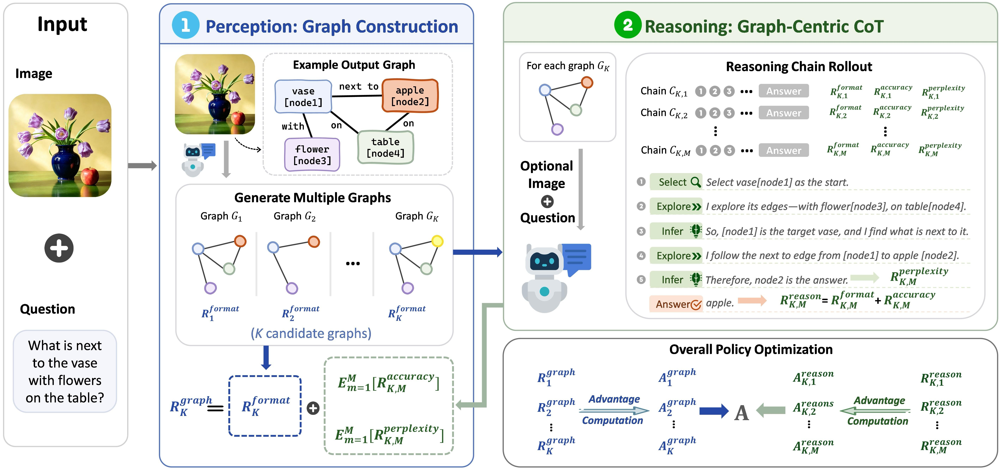
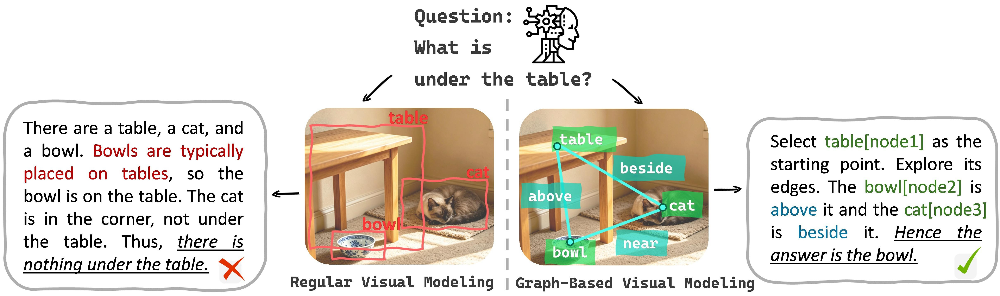

# GIST

**GIST: Graph-Guided Multimodal Reasoning with Stage-Specific Credit Assignment**



---

## Introduction

GIST is a reinforcement learning framework for improving multimodal reasoning in vision-language models (VLMs). It explicitly models spatial and logical relations among visual entities as relational graphs and uses these graphs to guide graph-centric reasoning.

### Core Idea

Existing visual modeling approaches typically focus on isolated visual entities (e.g., bounding boxes) while providing insufficient modeling of the spatial and logical relations among them. As a result, models may fail to fully leverage visual relations during reasoning.

GIST addresses this limitation by introducing explicit relational graphs to organize visual entities and their relations, guiding models to reason based on structured visual information. Through reinforcement learning, GIST optimizes both graph construction and graph-guided reasoning.



---

## Key Contributions

1. **Two-stage graph-centric multimodal reasoning framework**
   - **Graph Construction**: Identifies visual entities and models their spatial and logical relations as structured graphs.
   - **Graph-centric Reasoning**: Performs step-by-step reasoning over the constructed graphs.
   - Uses explicit graph structures to guide reasoning with visual relational information.

2. **Stage-specific reinforcement learning**
   - Introduces a nested sampling and stage-specific credit assignment mechanism.
   - Evaluates candidate graphs based on their average downstream reasoning performance.
   - Compares reasoning trajectories under the same graph to assess their relative quality.
   - Assigns targeted learning signals to graph construction and graph reasoning, respectively.

3. **Evaluation on seven multimodal reasoning benchmarks**
   - Covers physical perception tasks.
   - Covers diagram and quantitative reasoning tasks.
   - Demonstrates consistent improvements over strong baselines.

---

## Project Structure

```text
├── grpo-gr/                          # Core training code
│   ├── GRPO_GR.py                   # Main training script (two-stage GRPO)
│   ├── GRPO_GRTrainer.py            # Customized GRPO trainer (stage-specific credit assignment)
│   ├── rewards.py                   # Stage-specific reward functions
│   ├── relationReasoningDataset.py  # Dataset processing for relational reasoning
│   ├── vision_process.py            # Vision preprocessing pipeline
│   └── internVL_src.py              # InternVL model adapter
│
├── custom_tools/                    # External tools (bounding box annotation)
│   └── bbox-brush/
│       ├── app.py
│       ├── bbox_brush.py
│       └── tool_config.json
│
├── accelerate_configs/              # Distributed training configs
│   ├── deepspeed_zero2.yaml
│   ├── deepspeed_zero3.yaml
│   └── multi_gpu.yaml
│
├── scripts/                         # Training scripts
│   ├── train_base_config.sh
│   └── 2_a100_train_qwen_grounded_reasoning_base.sh
│
├── gradio_qwen.py                   # Interactive demo for Qwen2.5-VL
└── setup.sh                         # Environment setup script
```

## Installation

### Requirements

- Python 3.8+
- CUDA 11.8+
- PyTorch 2.0+

### Setup

```bash
bash setup.sh
```

### Usage

**Training**

```bash
bash scripts/2_a100_train_qwen_grounded_reasoning_base.sh
```

### Data Format

Training data should be provided in JSON format.
